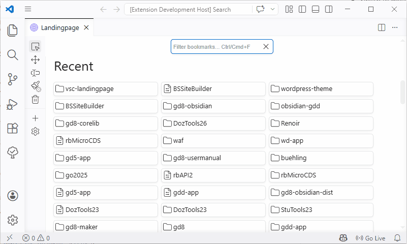

# Change Log

All notable changes to the "vsc-landingpage" extension will be documented in this file.

<!-- Check [Keep a Changelog](http://keepachangelog.com/) for recommendations on how to structure this file. -->

## [0.1.0] - 2026-07-27

Personal fork. Published under a different publisher id, so it installs alongside the
upstream extension rather than replacing it.

### Added

- **Clone a repository** from the landing page: a field at the top of the page, a button on
  the empty page, and a `Landingpage: Clone Repository` command. Hands off to VS Code's
  built-in Git extension, which picks the destination folder and handles credentials.
- **Per-bookmark icons.** Right-click a bookmark and choose from 20 icons, or clear it to go
  back to the file/folder icon.
- **Move to group** on the right-click menu, replacing drag and drop. Bookmarks in *Recent*
  are copied rather than moved.
- **Three group layouts** - list (new default), cards, and compact - cycled from the button
  in each group header.
- A **first-run page** with Clone / Open folder / New group, and a message when a filter
  matches nothing.
- `vsc-landingpage.maxRecentItems` setting to cap the *Recent* list (default 20).

### Changed

- **No more tool modes.** Clicking a bookmark always opens it. Renaming, colouring, icons,
  moving and removing are on the row's `...` button and the right-click menu. The tool
  sidebar is gone; New group and Settings moved into the page header.
- Redesigned throughout: a colour spine on every bookmark instead of a flood-filled card,
  paths in the editor's monospace font, group headers with a bookmark count, and a content
  column that reflows instead of sitting at a fixed card size.
- Bookmark colours now show as an accent, so bookmark text keeps the theme's contrast
  regardless of the colour chosen.

### Fixed

- **Clicking a bookmark in *Recent* could open a different project.** Entries were identified
  by their position in VS Code's history, which reorders whenever anything is opened.
- **Bookmarks to files opened as folders.** They were passed to `vscode.openFolder`, which
  treats a file as a workspace root instead of opening it.
- Group layout was written back to storage on every render rather than only when changed.
- The page no longer washes out in dark themes when a picker is open, and the picker itself
  is no longer rendered translucent.
- Switching between tools no longer reflowed every bookmark on the page.
- Bookmark icons are no longer blurry.
- The filter matches bookmark names only, and no longer leaves a page of empty group headings.

### Development

- **The project did not build from a clean checkout.** The stylesheet was compiled by nothing;
  `npm run compile` now builds it. `tsconfig.json` was missing the test runner's types.
- `npm run install-local` builds, packages and installs the extension in one step, also
  available as the "Build & install extension" task.
- The F5 debug session runs with an isolated extensions directory and profile, so it starts
  quickly and always opens the landing page.

## [0.0.4] - 2026-06

### Fixed

- Long label texts are now clipped also for card layouts, no more overlapping.
- CSS shade variables are now declared for prototype elements (internal/tech fix, no visible changes for users).
- Cursor images are now loaded from root assets path.

## [0.0.3] - 2026-04-04

### Added

- *Show Landingpage* appears in command palette now.
- Filter input field allows to highlight elements with keyword search.

## [0.0.2] - 2025-02-10

### Fixed

- Quick basic fix for toolbar icon colors which now use `--vscode-activityBar-foreground` to work with color themes.

## [0.0.1] - 2025-02-10

- Initial release

### Added 

- Render webview with scss and js contents.
- Create and delete groups 
- Import files or folders as bookmarks
- Open linked path on click
- Rename groups or bookmarks
- Drag and drop organisation of bookmarks within same or across groups
- Drag and drop sorting of groups
- Store and restore bookmarks in extension's globalStore
- Using [Lucide](https://lucide.dev/icons/folder-plus) icons
- Color picker for cards
- Card and List layouts for groups
- Display of recent elements from VS Code 
- Delete/Reset Landingpage

<!--
Future plans:

- Custom icon or image, esp. on cards
- Filter and/or sorting
- Export/Import landingpage model
- Renameable Recent Group
- Custom colors
- Collapse/Expand

-->