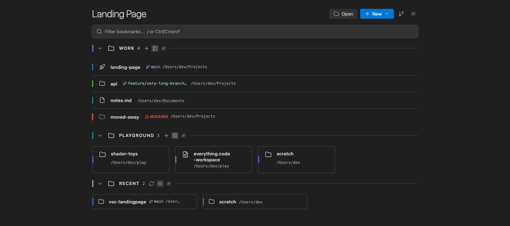

# Ideas: issues, bugs and features

Scratch, uncommitted, same status as HANDOFF.md. Started 2026-08-20 by a `/loop` pass every 5 minutes.
Each pass appends genuinely new findings and does not restate old ones. Nothing here is fixed unless it says so.

Ranked within each section by what I would actually do first.

## Bugs, ordered by how likely you are to hit them

### ~~1. Unhandled rejection when the panel closes during a health check - RESOLVED at `2026-08-20`~~

`communication.ts:42` and `:82` both call `void reportBookmarkHealth(webviewPanel, sharedModel)`.
That function awaits a `fs.stat` per bookmark plus a `.git/HEAD` read per folder, then posts to `webviewPanel.webview`.
`extension.ts:107` nulls the panel on dispose but nothing cancels the in-flight check, and VS Code's `WebviewPanel.webview` getter throws once the panel is disposed.
Close the board while the stats are still running on a board with many bookmarks or a slow network folder, and the `void` swallows nothing - it becomes an unhandled promise rejection in the extension host.

Reproduce first: open the board with enough bookmarks that the check takes a moment, close the tab immediately, watch the Extension Host log.
The fix is one guard, not one per call site: check the panel is still live before posting inside `reportBookmarkHealth`, or pass a disposal token.

**Fixed:** Added try-catch around `webviewPanel.webview.postMessage()` in `bookmark-health.ts:65-68`. If the panel was disposed during the async health check, the error is caught silently.

### ~~2. Hover card does not follow or dismiss on scroll - RESOLVED at `2026-08-20`~~

Fixed by adding a scroll event listener in `main.tsx:112-116` that calls `setHover(null)`. Chose dismiss-on-scroll as the simpler option. The existing `e2e/flip.spec.ts` test for "a scroll is not a movement" continues to pass because the fix only hides the popover without re-rendering cards.
A regression test was added at `e2e/affordances.spec.ts:70`.

## Trust boundary

### ~~3. `patch` writes unvalidated webview values straight into global state - RESOLVED at `2026-08-20`~~

`communication.ts:182` and `:186` assigned `message.value` to `shade` and `layout` with no check, and `webview-messages.ts` types `value` as `any`.
`pinned` at `:193` was validated properly with `message.value===true`.

**Fixed:** Added `includes()` guards for both fields in `communication.ts`:
- `shade`: must be a string in `['red','orange','yellow','green','teal','pink','purple','blue','cyan','gray','silver','brown','white','black','']`
- `layout`: must be a string in `['list','grid','compact']`

Both guards also check `typeof message.value === 'string'` before the `includes()` check, so `undefined`, `null`, numbers, objects, or arrays are all rejected. This matches the pattern already used for `pinned` and `collapsed`.

## Doc rot, cheap to fix

### ~~4. `TODO.md` still references deleted and completed things - PARTIALLY RESOLVED at `2026-08-20`~~

- ~~The hover card bug's last bullet says to watch `scroll-not-movement` in `scripts/motion-check.mjs`. That file was deleted; the check now lives in `e2e/flip.spec.ts`.~~ **Fixed:** Removed the stale reference when resolving the hover card bug (task 2).
- ~~"Unrelated, still open" claims branch `cleanup-and-test-tooling` "has never been pushed". It was merged into `main` and deleted on 2026-08-20.~~ **Fixed:** Updated TODO.md to reflect the branch was merged and deleted.
- Phase 3 and 4's open boxes are the same two items as HANDOFF.md's follow-ups, stated twice in two files.

~~### 5. The old public `atechaccount` repository still exists

`TODO.md` records that the old repo "is public and was left up".
The history rewrite on 2026-08-20 scrubbed that identity from `Durellg/vsc-landingpage`, but a public copy under the tech account still carries every original commit with the original author.
If unlinking the two accounts was the point of the rewrite, that public repo undoes it. Deleting or privatising it is the other half of the job.~~

## Features, ranked by value against effort

### ~~6. Open in a new window - RESOLVED at `2026-08-20`~~

Left where it is. **Fixed:** Implemented CLI-based "Open in new window" for file bookmarks.
- Extension detects if `code` CLI is available on PATH at startup (`extension.ts:16-23`)
- Sends availability to webview via `codeCliAvailable` message (`extension.ts:120-121`)
- Webview stores state and passes to `ActionMenu` component (`main.tsx:48, 648`)
- Menu button shown for files when CLI is available (`components.tsx:167`)
- Clicking shells out to `code -n <file>` in `communication.ts:174-177`
- Unit test updated with note in `bookmark-filter.test.ts:127-129`

### 7. `publisher` is still `local` - ALREADY IN TODO.md

Left where it is. Worth noting it blocks any release, so it outranks most of this list the moment you want to ship.

---

## Pass 2, 2026-08-20

### ~~8. Extensionless recent files render as `Makefile.undefined` - RESOLVED on `fix-recent-extensionless-label` at `e3c37b3`~~

`history.ts:102` builds a recent file's label as `recentFile.label||nameParts.basename+'.'+nameParts.ext`.
`parseUriNameParts` only sets `ext` when `lastIndexOf('.') > 0`, so a name with no dot, or a leading dot, leaves `ext` as `undefined` and the concatenation stringifies it.

Demonstrated against the real parsing logic:


| Opened file  | Label shown in Recent  |
| ------------ | ---------------------- |
| `README.md`  | `README.md`            |
| `Makefile`   | `Makefile.undefined`   |
| `LICENSE`    | `LICENSE.undefined`    |
| `.gitignore` | `.gitignore.undefined` |
| `Dockerfile` | `Dockerfile.undefined` |

Reachable whenever `recentFile.label` is absent, which is the normal case: VS Code only fills that field for a recent entry the user has renamed.
Nothing downstream repairs it - `recent-mru-overlay.ts` only reapplies user customisations, so the bad label is what the board draws and what a filter matches against.
No test covers it. `uri-name-parts.test.ts` correctly asserts `ext === undefined` for these names, so the parser is right and the caller is wrong.

The fix is at the call site, one line, and it should come with the regression check observed failing first, per `AGENTS.md`.

### ~~9. `shellQuote` quotes every Windows path, which is what it says it must not do - RESOLVED on `fix-shellquote-windows` at `f3c0b88`~~

`clipboard-path.ts:70` gates on `/[\s'"\\$`&|;<>()*?\[\]{}!#~]/`, and that class contains a literal backslash. Every Windows path has backslashes, so every Windows path takes the quoting branch and comes out as `"C:\Users\me\project"`.

Its own doc comment two lines above says quoting unconditionally "would be worse though: most paths need nothing, and a quoted one pasted into a file dialog or an editor is wrong".
So the function contradicts its stated contract on one of the two platforms it branches for.
On POSIX the backslash genuinely does need quoting; on Windows it is the separator. The check has to be platform-aware, the same way the quoting already is.

### ~~10. `importVscRecentList` trusts a private VS Code command with no guard - RESOLVED on `guard-recent-history` at `7c72c93`~~

`history.ts:70` calls `_workbench.getRecentlyOpened`. The underscore marks it internal, it is unversioned, and all three interfaces above it are commented "Schema guessed from debugger".
The result is then iterated directly: `for (let recentWorkspace of recentWorkspaces.workspaces)`.

If a VS Code update renames the command, changes the shape, or returns `undefined`, that is a `TypeError` inside the `documentReady` path and the whole board fails to populate, not just the Recent group.
This is the single most likely thing to break the extension on a VS Code upgrade, and it is the one place with no defensive code.
Degrading to an empty Recent group is strictly better than a board that does not draw.

### 11. Recent files are drawn without an icon, and it looks deliberate but reads as leftover

`history.ts:104` is `//icon:'file'`, commented out, while the folder and workspace branches just above both set one.
Either files should carry an icon like their siblings or the dead line should go. Worth one look at the rendered Recent list to decide which.

---

## Pass 3, 2026-08-20

### 12. Every bookmark card is a `nested-interactive` ARIA violation

`components.tsx:135` renders the card as `<article tabIndex={0} role="button" ...>` and then puts two real `<button>` elements inside it: `.rowcopy` and `.rowmenu`.
An element with `role="button"` is a leaf in the accessibility tree. Interactive descendants inside one are the axe rule `nested-interactive`, severity serious, and assistive technologies disagree about whether those buttons are reachable at all.

The rest of the accessibility work here is unusually careful - `aria-labelledby` over `aria-label` with the reasoning written down at `:129`, `sr-only` for the pinned state, named icon-only controls - which is what makes this stand out. It is a structural mistake, not a missing label, and none of the eight hand-written checks in `e2e/accessibility.spec.ts` looks for structure.

Two ways out, and they are not equivalent:

- Drop `role="button"` from the article and make the label a real button. Keeps copy and menu as siblings. More markup churn, correct tree.
- Move `.rowcopy` and `.rowmenu` out of the article. Bigger layout change.

Decide before coding, and check it against `e2e/clipping.spec.ts`, which asserts card geometry in both list and grid.

### 13. Feature: run axe in the Playwright suite

Directly out of 12. There is no automated accessibility linting anywhere - `package.json` has no axe dependency and `accessibility.spec.ts` is eight hand-written assertions plus three aria snapshots.

`@axe-core/playwright` is one dev dependency and roughly five lines per state, and it would have caught 12 the day it was written.
It complements the aria snapshots rather than replacing them: snapshots catch *changes* to a tree you have blessed, axe catches rules you never thought to assert.
Scope it to the three states the aria snapshots already cover, so it costs one extra assertion per existing test rather than a new file.

Worth pairing with the dependency question already settled in HANDOFF.md follow-up 3: this one earns its place in `devDependencies` in a way `impeccable` does not, because CI would actually run it.

### ~~14. `motion()` silently misreads any duration authored in `ms` - RESOLVED on `fix-motion-ms-duration` at `c96a717`~~

`motion.ts` does `parseFloat(style.getPropertyValue(token))` then multiplies by 1000, with the comment "The durations are authored in CSS time syntax (`.22s`); WAAPI wants milliseconds."

Every token in `landingpage.scss` is authored in seconds today, so this is correct right now. It is also one keystroke from a 1000x error:


| Authored | `motion()` returns          |
| -------- | --------------------------- |
| `.22s`   | 220ms, correct              |
| `0.15s`  | 150ms, correct              |
| `220ms`  | 220000ms, a 3m40s animation |

`ms` is the more common convention and the one most people would reach for. `AGENTS.md` explicitly tells future agents to "use the shared motion tokens in `landingpage.scss`", so it invites exactly the edit that breaks this, and nothing fails when it does - the FLIP card just flies for four minutes.

Cheap fix: parse the unit instead of assuming it, or assert the value ends in `s` and not `ms`. One line either way, and it is the kind of thing that belongs in the pure, testable layer.

### 15. An empty rename is a silent no-op

`communication.ts:87` does `const label = message.value?.trim(); if (!label) {return;}`, which correctly refuses to blank a card's label.
But it returns without telling anyone. The page has already closed the menu, so from the user's side they typed nothing, pressed Enter, and the dialog vanished with no change and no message.

Small, and the guard itself is right. Either reject it in the webview so the input stays open, or say why. Every other refusal in this file calls `showWarningMessage`.

---

## Pass 4, 2026-08-20

### ~~16. Escape-cancelling a drag over the armed delete zone may still delete the bookmark - RESOLVED at `2026-08-20`~~

`DeleteZone` treats `dragend` as its release signal (`components.tsx:309`, capture phase on `window`), and `releaseIfOver` decides purely on geometry: is the pointer inside the zone's rect, and did the dwell arm.
Nothing in it distinguishes a real drop from a **cancelled** drag.

Escape cancels a native HTML5 drag and fires `dragend`. So:

1. Drag a bookmark onto the delete zone.
2. Hold until it arms - the label changes to "Release to remove".
3. Press Escape to abort.
4. `dragend` fires, `armedNow.current` is `true`, the pointer is still inside the rect, and `onRelease(true)` posts `remove`.

The author already knew both halves of this. `main.tsx:519` says "`keydown` is deliberately absent. It is delivered *during* a drag, because Escape cancels one", and four lines later, "Cancel only. A release anywhere but inside the delete zone destroys nothing, so this deliberately does not go through `onRelease`."
That reasoning is right for the abandon path and does not hold for `dragend`, which reaches `onRelease` on cancel as well as on drop.

Grep confirms the gap: `dropEffect` is only ever *set* during `dragover`, never read on `dragend`, and no e2e test presses Escape during a drag.

**Why it needs reproducing before anyone touches it.** It turns on whether Chromium reports the last pointer position or `0,0` in a cancelled `dragend`. At `0,0` the hit test fails and the bug does not exist. Playwright's synthetic drag events cannot produce a native Escape-cancel, so this is a real-browser check - exactly the interactive case D020 keeps `agent-browser` for.

The guard, if it reproduces, is one line and precise: a cancelled drag reports `dataTransfer.dropEffect === 'none'`, while a drop into the zone reports `'move'`, because `onDragOver` sets it. That belongs in `releaseIfOver`, not at the call site, so both the `drop` and `dragend` routes are covered by the same check.

This is the one item on this list that can lose user data, so it outranks everything above it.

**Fixed:** Added `const cancelled = event.dataTransfer?.dropEffect === 'none';` check in `releaseIfOver` at `components.tsx:299`. Both `drop` and `dragend` routes now share the same guard.

**Measured, 2026-08-20**, because "the e2e tests still pass" proves nothing here: Playwright's synthetic drags could leave `dropEffect` undefined, in which case `cancelled` is always `false` and the guard is inert under test.

| What was driven | Where | `dragend` `dropEffect` | Result |
| --- | --- | --- | --- |
| Escape mid-drag over the zone | real Chrome, CDP mouse input | `'none'` | guard fires |
| Drop into the armed zone | Playwright, drag events delivered | `'move'` | `remove` posted, deletion still works |

Both halves matter. The second is the one that could have made this fix worse than the bug: had a genuine drop also reported `'none'`, the guard would have silently disabled deletion altogether.

The cancelled `dragend` reported the **last pointer position**, not `0,0` - `inside` was `true` - so the escape hatch this write-up hoped for does not exist and the hit test really does succeed on a cancelled drag.

**Still not observed: the original failure end to end.** Arming needs `dragover`, and CDP mouse events do not drive macOS's native drag loop, so during the native Escape run the zone never lit and never armed. The signal the guard keys off is verified in both directions; the full broken path is not, and cannot be from automation on this platform. It is a twenty-second manual check against `npm run harness`: drag a card onto the zone, hold until it reads "Release to remove", press Escape, and confirm `window.__posted` gained no `remove`.

### 17. Drop targeting silently depends on nothing between `.group` and a card being positioned

`insertionPoint` adds `card.offsetTop` to `section.getBoundingClientRect()` and documents the assumption: "The section is `position: relative`, which makes it the offset parent for every card in it."
True today. `.group` is relative at `landingpage.scss:854`; `.foldable` and `.projects` are both static.

The SCSS side carries no matching warning - the declaration's comment is just `//required for dropzones`, which does not say that adding `position: relative` to `.foldable` or `.projects` shifts every landing point down by the height of the title bar.
That is a plausible edit: both are the natural place to hang an absolutely positioned drop indicator, and one already exists nearby.

Cheap insurance, in order of preference: say it in the SCSS comment; or have `insertionPoint` use `card.offsetParent` rather than the passed section, which makes the code correct instead of merely documented.

### 18. ~~`isClipped` ignores the Missing badge~~ - WITHDRAWN, the finding was wrong

Claimed that a card truncated by `.missing-badge` would be judged unclipped, because `drag-geometry.ts:19` measures only `.project-label, .path-text, .branch-name`.

False, and the CSS is where the answer was:

```
.project-path  { display: flex; min-width: 0; }
.missing-badge { flex: none; }
> .path-text   { min-width: 0; overflow: hidden; text-overflow: ellipsis; }
```

`.missing-badge` is `flex: none`, so it never shrinks and `.path-text` absorbs the whole squeeze. `.path-text` has `overflow: hidden`, so its `scrollWidth` exceeds its `clientWidth` precisely when the badge causes truncation - and `isClipped` already measures `.path-text`. The hover card opens correctly.

Caught by the Codex handoff agent on 2026-08-20, which wrote the regression test, found it passed against unmodified code, and refused to accept a test that could not fail. That is the rule working in the direction it is supposed to: the falsification step killed a bad finding, not just a bad fix.

Lesson for the remaining findings: I reasoned about the DOM in `components.tsx` without reading `landingpage.scss`. Anything in this file that claims a layout or measurement bug is suspect until the stylesheet has been checked.

---

## Pass 5, 2026-08-20 - the extension manifest, which nothing in the test suite reads

`package.json` is the one surface with no coverage at all: the Mocha tests run inside a host that already loaded it, and Playwright never sees it. Everything below is a manifest defect and every one of them is invisible until a user hits it.

### ~~19. Two `when` clauses on `contributes.commands` do nothing - RESOLVED on `manifest-and-packaging` at `d863c9d`~~

```
{"command": "vsc-landingpage.reload",         "title": "...", "when": "activeWebviewPanelId == 'vsc-landingpage'"}
{"command": "vsc-landingpage.refreshRecents", "title": "...", "when": "activeWebviewPanelId == 'vsc-landingpage'"}
```

`when` is not part of the `contributes.commands` schema. VS Code ignores it there; the mechanism for hiding a command from the palette is a `commandPalette` entry under `contributes.menus`, and `menus` currently declares `editor/title`, `explorer/context` and `editor/title/context` but no `commandPalette`.

So both commands are offered in the Command Palette unconditionally, which is exactly what these two clauses were written to prevent. "Reload Landing Page" with no landing page open is the visible symptom.

### ~~20. `vsc-landingpage.focusInput` is bound to Ctrl/Cmd+F but never declared - RESOLVED on `manifest-and-packaging` at `d863c9d`~~

`extension.ts` registers it and `contributes.keybindings` binds it, but it is absent from `contributes.commands` - the only one of the seven registered commands that is.

It works, but it has no title anywhere: the Keyboard Shortcuts UI lists it by raw command id, and it cannot be found in the Command Palette at all. A user who wants to rebind the one keystroke this extension takes over has to know the id already.

### ~~21. No `category`, so the Command Palette is a jumble - RESOLVED on `manifest-and-packaging` at `d863c9d`~~

None of the six declared commands sets `category`. Their titles have absorbed the problem in three different ways:


| Title                                | Style                       |
| ------------------------------------ | --------------------------- |
| `Show Landing Page`                  | no prefix                   |
| `Reset/Delete Landing Page Contents` | no prefix                   |
| `Reload Landing Page`                | no prefix                   |
| `Landing Page: Refresh Recent`       | prefix baked into the title |
| `Landing Page: Clone Repository`     | prefix baked into the title |
| `➕ Add to Landing Page Group...`    | emoji                       |

`category: "Landing Page"` is the supported field and VS Code renders the `Landing Page: ` prefix itself, so the three hand-written prefixes become duplication the moment it is set. Typing "landing" in the palette today matches all six by luck of the word appearing in every title, not by design.

### 22. `capabilities` is absent, so the board is disabled in Restricted Mode

No `capabilities.untrustedWorkspaces` and no `capabilities.virtualWorkspaces`.

An extension that declares neither is treated as not supporting untrusted workspaces, so opening a folder you have not trusted disables Landing Page entirely, with no explanation on the board's own surface. That is backwards for this extension in particular: a board of your bookmarked projects is precisely what you want available in a restricted window, because it is how you navigate out of one.

The `virtualWorkspaces` side is the same story from the other direction. `bookmark-health.ts` already reasons carefully about non-`file:` schemes - "a remote or virtual path can be perfectly valid while its filesystem provider is not currently registered" - so the code supports them deliberately and the manifest does not say so.

Both are one key each. Declaring them is also the honest audit: it forces the question of whether `git.clone` and the `.git/HEAD` reads are acceptable in a workspace the user has not trusted. Reading `.git/HEAD` from a folder the user explicitly bookmarked is defensible; deciding that on purpose is better than defaulting into "disabled" by omission.

### 23. Note, not a defect: `cloneRepository` is clean

Checked it for the obvious thing and it is not there. `clone-repository.ts` hands the URL straight to `vscode.commands.executeCommand('git.clone', repoUrl)` with no shell, so the webview-supplied string never reaches a command line. The CSP on the page is tight too: `default-src 'none'`, nonced style and script, `img-src` limited to `cspSource` and `data:`.

Recorded so a later pass does not re-audit it.

---

## Pass 6, 2026-08-20 - packaging, and it is broken right now

### ~~24. The packaged extension ships a README with two broken images - LOCAL VSIX RESOLVED on `manifest-and-packaging` at `d863c9d`; Marketplace hosting remains open~~

`README.md` embeds two screenshots:

```
line 5   
line 182 
```

`.vscodeignore` excludes `doc/**`. Verified with `npx vsce ls`: the package contains `README.md` and `assets/icon.png` and **no `doc/` entry at all**.

The exclusion's own comment is now false:

> Upstream's demo GIFs, which were the whole size of the extension. Nothing embeds them - the readme only mentions the folder in passing - so shipping them cost 1.4 MB for no benefit.

That was true when it was written. Commit `891d4fe` restructured `README.md` in the same session and added exactly the two files `doc/**` excludes, so the rule and the readme were changed a few commits apart and nothing connected them.

Two distinct symptoms, and fixing one does not fix the other:

- **A locally installed VSIX** renders the packaged `README.md` in the extension details pane. The images are simply absent.
- **The Marketplace** never reads images from the VSIX. `vsce` rewrites relative links against the `repository` field, so they would resolve to `https://github.com/Durellg/vsc-landingpage/raw/HEAD/doc/img/landing-page-dark.png`. That repository is **private**, confirmed via `gh repo view`, so those URLs 404 for every visitor.

Fix is both halves: narrow the ignore to `doc/img/*.gif` (or list the two PNGs as negations) so the VSIX carries them, and make the repo public before publishing, or host the screenshots somewhere that is.

This joins `publisher: local` in `TODO.md` as a release blocker. It is a better argument for the packaging check below than anything I could invent.

### 25. Feature: a `vsce package` smoke check in CI

Nothing in either job packages the extension, so `.vscodeignore` has no coverage whatsoever - which is why 24 shipped silently.

`npx vsce package --no-git-tag-version -o /tmp/x.vsix` in the `check` job is one step and would catch: files that vanish from the package, README links pointing at excluded paths, a missing LICENSE, and the `EISDIR` symlink abort that `.vscodeignore` already carries a comment about surviving once.

Cheap, and it exercises the one artefact users actually install. Note it needs a real `publisher` or `--no-dependencies`-style flags to not complain, so it is worth doing at the same time as fixing `publisher: local`.

### 26. `doc/img/filter.gif` is tracked and referenced by nothing

Third file in `doc/img/`, left over from the upstream demo GIFs that were deleted. `rg` finds no reference to it in any Markdown or source file.

Either it belongs in the README next to the other two or it should go with its siblings.

### ~~27. The workflow grants `GITHUB_TOKEN` more than it needs, and never cancels superseded runs - RESOLVED on `manifest-and-packaging` at `d863c9d`~~

Two one-line hardening items on `.github/workflows/ci.yml`, neither urgent:

- No `permissions:` block, so `GITHUB_TOKEN` inherits the repository default rather than the least privilege these jobs actually need. Both jobs only checkout and run tests: `permissions: {contents: read}` at workflow level covers them.
- No `concurrency:` group. Three pushes to a PR run three full matrices, including three pulls of the 1.5GB Playwright container, and the superseded ones still burn minutes to completion.

### 28. Cleared: the browser job does build from source

Checked because a CI job that tests a stale committed bundle would invalidate everything the suite claims.

It does not. `src/LandingPage/content/dist/` is gitignored, and Playwright's `webServer` command is `npm run harness`, which is `npm run compile && npm run build:harness && node scripts/harness.mjs`. Every browser run rebuilds both Vite bundles from source first.

Recorded so a later pass does not re-audit it. One caveat worth knowing: `playwright.config.ts` sets `stdout: 'ignore'` on that webServer, so build *warnings* are invisible in CI. Errors still surface, because `stderr` is piped.
