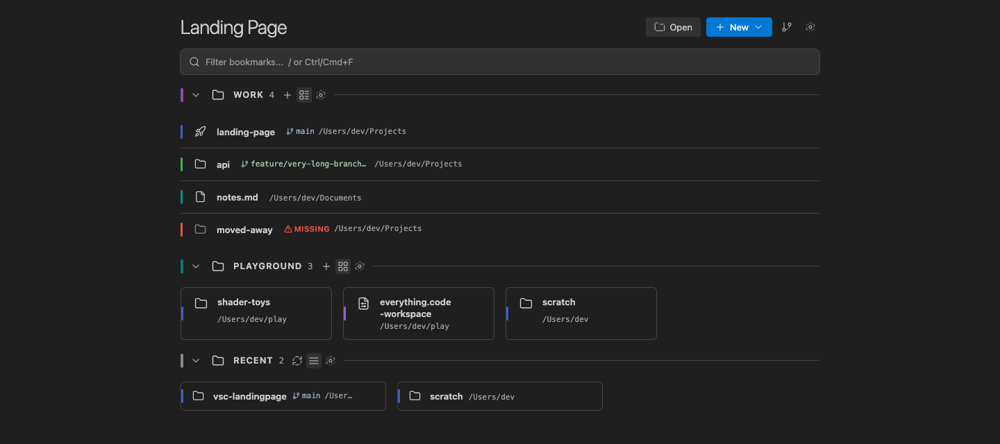

# Landing Page

Landing Page is a customizable VS Code start page for bookmark groups and recently opened files, folders, and workspaces.

A fork of [René Bühling's Landing Page](https://github.com/renebuehling/vsc-landingpage), MIT licensed.
It is not on the Marketplace yet; build and install it locally with the steps in [DEVELOP.md](DEVELOP.md).

Contributors: [DEVELOP.md](DEVELOP.md) is the build, test and packaging workflow, [DECISIONS.md](DECISIONS.md) records durable product and architecture decisions, and [AGENTS.md](AGENTS.md) is the runbook for coding agents.

## What it does

This extension replaces the start page with a bookmark board: groups of bookmarks pointing at folders, workspaces and files, plus a mirror of VS Code's recently-opened list.

VS Code's own *recently used* list is strictly temporal and does not reflect how you actually work.
You want the projects you are currently living in kept in sight, even during a week spent somewhere else.
So the board shows both: **Recent**, mirrored from VS Code, and your own groups, which you name, order, colour and pin.

## Opening things

The page opens automatically in a window with no folder open (`autoshowOnStartup`, on by default).
Otherwise run **Show Landing Page** from the command palette.

| Action | Result |
|---|---|
| Click a bookmark | Opens it in the current window |
| `Ctrl`/`Cmd`+click | Opens it in a **new window** |
| `Ctrl`/`Cmd`+`Enter` | Same, from the keyboard |

New-window opening applies to folders and workspaces only.
VS Code has no new-window form for a plain file, so the option is withheld rather than offered and then ignored.

If the target is already open in another window, VS Code may focus that window instead.

Hovering a bookmark - or reaching it with the keyboard - opens a small detail card showing the **full path**, the branch, and a warning if the target has gone.
Cards truncate long paths to stay scannable, so this is where you read the whole thing.
It is display only: it appears only when something is actually cut off, so nothing you need to click lives in it.

**Copying a path** is on the bookmark itself - a copy button appears beside the `...` button when you hover or focus a card, and turns into a tick once the path is on the clipboard.
It is also on the bookmark menu and on `Ctrl`/`Cmd`+`C` for the focused card.
Paths are shell-quoted only when they contain something a shell would mangle.

## Driving it from the keyboard

The whole board works without a mouse.

| Key | Does |
|---|---|
| `↑` `↓` `←` `→` | Move between bookmarks |
| `Enter` / `Space` | Open the focused bookmark |
| `Ctrl`/`Cmd`+`Enter` | Open it in a new window |
| `Home` / `End` | First / last bookmark on the board |
| `/` or `Ctrl`/`Cmd`+`F` | Jump to the filter |
| `Esc` | Close a menu, then clear the filter, then drop focus |

Arrow movement is geometric rather than positional, so it behaves the same in list, grid and compact layouts - `↓` from a card in the right column of a grid lands in the right column of whatever is below it.

Everything reachable by dragging is reachable without one.
*Move to group* on a bookmark's menu is the keyboard route for moving a bookmark; *Move group up* and *Move group down* on a group's menu are the route for reordering groups.
Opening a menu moves focus into it and closing it hands focus back to whatever opened it, so `Esc` always returns you to where you were rather than to the top of the page.

Screen reader users get the path, the branch and the missing-target warning read out with each bookmark, and a polite live region announces a copied path, a finished **Recent** refresh, and how many bookmarks the current filter matches.

## Filtering

Type in the filter field to narrow the board.
The query is matched against **labels and full paths**, and split on spaces so every term must match somewhere:

- `documents` finds a file by the folder it lives in, not just by its name.
- `vsc land` finds `vsc-landingpage`.
- `dev api` picks one `api` out of several checkouts.

Naming a **group** shows that entire group.
A filter also temporarily opens any collapsed group containing a match, without disturbing its stored collapsed state.

## Groups

Create a group from the **New** menu in the page header.

- **Reorder** - drag a group by its title bar.
  **Recent** is pinned last and is neither draggable nor a drop target for groups.
- **Collapse** - the chevron beside the group icon folds it to its header.
  This is remembered across reloads and windows.
- **Layout** - the layout button cycles `list` → `grid` → `compact`.
- **Customise** - right-click a group, or use its settings button, for rename, accent colour and custom icon.

## Bookmarks

Add bookmarks two ways, and they differ by where the bookmark lands:

- The **Add** button on a group header opens a composer beneath *that* group, so the destination is implied by where you clicked.
- The page header's **New** menu is global, so it asks which group to use - except for **Folder on disk**, which opens the native dialog straight away and files the result in your first group.

You can also right-click any file or folder in the **Explorer** and choose *Add to Landing Page Group* - that works even if the landing page has never been opened in the window.

The same menu carries *Open in New Workspace*, which opens the clicked folder as a second workspace without disturbing the one you are in.
Right-click a file instead and it reads *Open Parent Folder in New Workspace*, because a workspace is a folder and that is the folder you get.
On macOS with `window.nativeTabs` enabled it arrives as a tab in the current window rather than a separate one.
Both items are on the editor tab's right-click menu too.

**Drag a bookmark** to move it - onto another group, or to a new position inside its own.
The destination group is outlined while you drag, and a line shows exactly where the card will land.
Dragging one **out of Recent copies it**, since Recent is rebuilt from VS Code's history and cannot be edited; and nothing can be dropped *into* Recent, so it is never outlined.

*Move to group* on the menu below does the same thing through a quick pick, which is easier when the destination is off screen and is the only route from the keyboard.

**To get rid of a bookmark**, drag it to the panel that appears on the right while you are dragging.
It will not act on a card flicked across it on the way somewhere else: rest on it for a moment and it turns red and says *Release to remove*, and only then does letting go do anything.
Dragging a **Recent** entry there hides it from this page rather than removing it, since Recent is VS Code's own history - the Recent group's menu restores everything hidden.
Both actions are also on the bookmark's own menu, which is the keyboard route.

Right-click a bookmark (or use its `...` button) for:

| Item | Notes |
|---|---|
| Open / Open in new window | New window for folders and workspaces only |
| Pin to top | Holds it at the top of its group |
| Rename | Inline, in the menu |
| Accent colour | Paints the spine and icon, not the card body |
| Custom icon | Any of the built-in glyphs |
| Move to group | Native quick pick |
| Remove | Confirms in place; the linked target is untouched |

Entries in **Recent** get a reduced version of this menu - see [Understanding *Recent*](#understanding-recent).

**Pinning sorts, it does not reorder.** Unpinning returns a bookmark to where it was, and two pinned bookmarks keep their stored order relative to each other rather than the order you pinned them in.

### Missing targets

A bookmark in one of *your* groups whose folder or file has been moved, renamed or deleted is marked with a red spine and a **Missing** badge.
The check runs when the page opens and whenever **Recent** is refreshed, which includes the panel coming back into view.

In **Recent** a missing entry is dropped, and the list reaches further back into VS Code's history to make up the number - `maxRecentItems` counts entries you can actually see, so hiding or losing a few never shrinks the list below it.
Recent mirrors what you have opened rather than a list you curate, and the list is rebuilt from VS Code's history on every sync, so a dead entry there is noise you have no way to remove.
In a user-created group, a missing bookmark is marked but never hidden or disabled - you may still want to open it, rename it, or remove it, and quietly dropping a bookmark you made is not this page's decision.

Only local (`file:`) targets are checked.
A remote or virtual path can be perfectly valid while its filesystem provider is not currently registered.

### Git branch

Folder bookmarks that are git repositories show their checked-out branch.
This is read from `.git/HEAD` directly rather than through the built-in Git extension, so it does not depend on that extension being enabled or on which repositories it has decided to open.
Linked worktrees and submodules work; a detached HEAD shows a short commit id.

## Cloning a repository

The **clone** button in the page header takes a Git URL.
It hands off to VS Code's built-in `git.clone`, which owns the destination picker, credentials and the *Open / Add to Workspace* prompt.
The clone then shows up in **Recent** like anything else.

## Understanding *Recent*

**Recent** mirrors VS Code's own recently-opened list - the same entries as *File > Open Recent*.
It is generated, so its contents are rebuilt from VS Code on every sync and most editing is locked.

**It can go stale**, because VS Code's history keeps changing while the page sits in a background tab - opening a project in another window is the everyday case.
Three ways to refresh it:

- the **refresh** button on the Recent group header,
- automatically, whenever the panel comes back into view,
- the **Landing Page: Refresh Recent** command.

What you *can* do to Recent:

| | |
|---|---|
| Change its layout, accent colour and icon | Yes - view settings, independent of the data source |
| Colour or re-icon an individual entry | Yes - stored as an overlay so it survives each rebuild |
| Pin an entry | Yes |
| Rename entries, reorder them, or remove them | No |
| Copy an entry into one of your own groups | Not currently offered - see below |
| Hide an entry from this page | Yes - *Hide from Landing Page*, local only; VS Code's own history is never touched. The group menu restores everything hidden. |

To keep a Recent project around permanently, bookmark its folder into one of your own groups (**Add** on that group's header, or right-click the folder in the Explorer).
The *Move to group* action is deliberately not offered on Recent entries.

## Theming

The page adopts your editor theme rather than bringing its own.
Every colour resolves to a `--vscode-*` theme variable, so light, dark and high-contrast all work.
The only fixed colours are the accent palette you pick bookmark shades from.

## Settings

| Setting | Default | Meaning |
|---|---|---|
| `vsc-landingpage.autoshowOnStartup` | `true` | Open the landing page automatically in empty windows. |
| `vsc-landingpage.maxRecentItems` | `20` | How many entries the **Recent** group shows. `0` means no limit. |

## Commands

| Command | Notes |
|---|---|
| Show Landing Page | Opens or focuses the page |
| Landing Page: Refresh Recent | Rereads VS Code's recently-opened list |
| Landing Page: Clone Repository | Same as the clone button |
| Add to Landing Page Group | Explorer and editor-tab context menus |
| Open in New Workspace | Explorer context menu, on a folder |
| Open Parent Folder in New Workspace | Explorer context menu on a file, and the editor-tab menu |
| Reload Landing Page | Re-syncs the page from the stored model |
| Reset/Delete Landing Page Contents | Removes all groups and bookmarks. Not undoable. |
